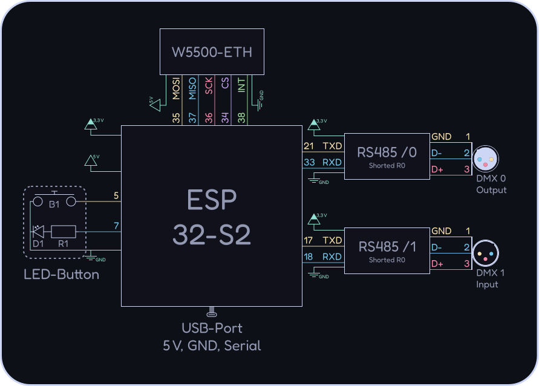

# ChaosDMX

> [!NOTE]
> Built with Rust (`esp-hal`, `no_std`, embassy). The legacy Arduino-based firmware lives in the [legacy/arduino branch](https://github.com/HendrikRauh/dmx-interface/tree/legacy/arduino).

ChaosDMX is an open-source, multi-protocol DIY [DMX](https://en.wikipedia.org/wiki/DMX512) interface that acts as a versatile bridge between lighting
control software (e.g., [QLC+](https://www.qlcplus.org/)) and physical stage equipment like fixtures, spotlights, moving heads, and fog machines.
It features two fully configurable ports that can be individually set up as either DMX-Input or DMX-Output.
The interface supports [Art-Net](https://art-net.org.uk/) and [sACN / E1.31](https://entertainment.sundrax.com/blog/ultimate-guide-sacn-control-lighting-over-network) and is able to operate over an Ethernet connection or over Wi-Fi.

______________________________________________________________________

## 🛒 Parts

> [!NOTE]
> We linked some of our components in the table below, feel free to use a vendor and manufacturer of your choice.

| Count | Part |
| ---: | --- |
| 1x | [ESP32 (Lolin S2 Mini)](https://de.aliexpress.com/item/1005006985001838.html?spm=a2g0o.order_list.order_list_main.212.23795c5fCZ7bIM&gatewayAdapt=glo2deu) |
| 2x | [RS485](https://de.aliexpress.com/item/1005006391142478.html?spm=a2g0o.order_list.order_list_main.102.23795c5fCZ7bIM&gatewayAdapt=glo2deu) |
| 1x | [W5500-ETH](https://de.aliexpress.com/item/1005006127400904.html?spm=a2g0o.order_list.order_list_main.137.23795c5fCZ7bIM&gatewayAdapt=glo2deu) |
| 1x | [LED-Button](https://de.aliexpress.com/item/1005003595039032.html?spm=a2g0o.order_list.order_list_main.35.23795c5fCZ7bIM&gatewayAdapt=glo2deu) |
| 1x | ♂️-XLR-socket |
| 1x | ♀️-XLR-socket |

Additionally, you need:

- some wires
- soldering equipment
- 3D-printer
- some screws (see [case](#-case))
- heat shrink tubing

______________________________________________________________________

## 🔌 Wiring

> [!IMPORTANT]
> You need to enable the termination resistor required for DMX for the first and last devices in the chain on your board. On the board we used (RS485 boards) we had to short-circuit `R0` to do so.

The following diagram demonstrates how to wire the components together, in the table below you can see how to connect the pinout of the ESP32 with your project.



| GPIO | Usage |
| ---: | --- |
| GND | GND to others |
| 3,3 V | VIN on RS485 |
| 5 V / VBUS | VIN on W5500 |
| 0 | Onboard Button |
| 5 | Ext. Button |
| 7 | Ext. LED |
| 15 | Onboard LED |
| 17 | U1TXD |
| 18 | U1RXD |
| 21 | U0TXD |
| 33 | U0RXD |
| 34 | SPI CS |
| 35 | SPI MOS |
| 36 | SPI SCK |
| 37 | SPI MISO |

______________________________________________________________________

## 🚀 Installation

1. Connect the ESP32 to your computer using a USB cable.
2. Flash the firmware to the ESP32 using the provided [flash tool](https://hendrikrauh.github.io/dmx-interface/flasher/) or by using a command line tool of your choice (e.g., `espflash`).<br>You can find the latest firmware release on the [releases page](https://github.com/HendrikRauh/dmx-interface/releases).
3. Connect to the WiFi network with the [default configuration](#default-config) and access the web interface.

> [!TIP]
> If the ESP32 does not show up as a serial device, you might need to place it in bootloader mode.

______________________________________________________________________

## 📦 Case

All print files can be found in the folder `assets/case`.
Alternatively, you can view the current case on [OnShape](https://cad.onshape.com/documents/7363818fd18bf0cbf094790e/w/52455282b39e47fbde5d0e53/e/9bec98aa83a813dc9a4d6ab2) where you can export the files in a format of your choice.
Feel free to design your own case (and maybe address the [issues with the current one](https://github.com/HendrikRauh/dmx-interface/issues/92)) and share it with us!


In addition to the print you will need:

| Count | Part | Location |
| ---: | --- | --- |
| 6x | M2x5 screw | Case lid, ESP32 |
| 2x | M2.5x5 screw | W5500 |
| 4x | M3 screw | XLR sockets |
| 4x | M3 nut | XLR sockets |

______________________________________________________________________

## 💡 Status LED

We have a status LED-Button that shows the current state of the device.

| LED | Description |
| --- | --- |
|  | no power; LED deactivated |
|  | powered on; normal |
|  | startup |
|  | warning |
|  | resetting |
|  | error |

______________________________________________________________________

## ⚙️ Config

You can configure the device by connecting to the WiFi network and accessing the web interface via the default (listed below) or configured IP address.

### Default config

To reset the settings, hold down the button and connect the ESP to the power supply, the LED will flash rapidly. After 3 seconds the LED will turn solid and the settings are reset. If you release the button early, you will abort the reset and the LED will flash slowly.

| Setting | Value |
| --- | --- |
| Type | WiFi AP |
| SSID | ChaosDMX-□□□□ |
| Password | ChaosDMX |
| IP-Address | 192.168.4.1 |
| DMX0 | OUTPUT; Universe 1 |
| DMX1 | INPUT; Universe 2 |
| LED Brightness | 10 % |

______________________________________________________________________

## 🧑‍💻 Development

We provide a ready-to-use development environment using Nix, but you can also set up the environment manually if you prefer to do so. If you do not want to use Nix make sure to install the required tools listed in the `buildInputs` section in `flake.nix`.
If you are on Windows you can either use [WSL](https://learn.microsoft.com/en-us/windows/wsl/) and follow the instructions below inside the WSL session, or use the [development container](#development-container) which needs no local Nix setup. For the USB pass-through you might need to install [usbipd-win](https://github.com/dorssel/usbipd-win#how-to-install).

### Setup NIX

For usage of the development environment, having the nix package manager with flakes-support installed on your system is required.
There are two main ways to install the nix package manager on your system.

#### via determinate.systems (recommended)

Have a look at [their website](https://determinate.systems/nix-installer/), there is a single command to run, after this you may restart the system or log out.

#### via nixos.org

If you want to use the bare nix installer visit [nixos.org/download](https://nixos.org/download/) and follow the steps there. When you are done with the installation of nix you need to enable flakes support by adding the following line to your `~/.config/nix/nix.conf`:

```conf
experimental-features = nix-command flakes
```

### Setup direnv (optional)

Optionally, you are able to use direnv to automatically enter the development environment whenever you navigate to the project folder. Further installation instructions can be found on [their website](https://direnv.net/docs/installation.html).

When using it for the first time, you need to allow the `.envrc` file by running `direnv allow` in the project folder.
Afterwards, you can simply navigate to the project folder and you will automatically enter the development environment.

### Development container

Instead of installing Nix locally (e.g. on Windows), you can run the whole development environment in a [development container](https://containers.dev/).
The `.devcontainer/` setup layers the official Nix feature on a plain Ubuntu base — all tools still come from `flake.nix` via `nix develop`, exactly like a native setup.

Requirements: a container engine with the [Dev Containers extension](https://marketplace.visualstudio.com/items?itemName=ms-vscode-remote.remote-containers) in VS Code — on Windows that is [Podman](https://podman.io/) (see below), on Linux [Docker](https://docs.docker.com/get-started/) or Podman.

The configuration is engine-neutral: `devcontainer.json` contains no container-engine flags.
The development container runs as `root` deliberately — on every supported engine the bind-mounted workspace belongs to container uid 0
(Windows drvfs forces `uid=1000`, which rootless Podman maps to container root; Docker Desktop mounts as root), so the session user
always owns the workspace and `npm`, `vite` and `git` work without engine-specific UID mappings.
Hosts where `docker` is Podman in disguise need the VS Code user setting `"dev.containers.dockerPath": "podman"` (CLI users pass `--docker-path podman` instead): that is the case on NixOS (`/usr/bin/docker` is a Podman symlink reporting itself as "docker")
and on hosts with only Podman installed (no docker shim at all). Docker users skip this.

macOS is unsupported: USB devices cannot reach the container VM there at all, so the board never shows up on `/host-dev` — the usbipd/WSL mechanism has no macOS equivalent.

1. Open the repository in VS Code and run **Dev Containers: Reopen in Container** from the command palette.
2. The first build downloads the Xtensa toolchain during `postCreateCommand` (5–15 minutes — `esp-rs-nix` ships pre-built artifacts but has no binary cache).
3. Work as described below: `inv build`, `inv check`, `inv format`, `inv web:dev` (Vite dev server — port 5173 is forwarded to your host automatically). Integrated terminals start in `nix develop` automatically.

Alternatively, drive the same setup from a terminal with the
[devcontainer CLI](https://github.com/devcontainers/cli) (validated end-to-end on the
Windows/Podman setup below — the `ghcr.io/devcontainers/cli` image cannot be pulled
anonymously anymore, so install the CLI itself):

```sh
# inside the Podman machine (Windows: wsl -d podman-machine-default)
curl -fsSL https://raw.githubusercontent.com/devcontainers/cli/main/scripts/install.sh | sh
devcontainer up --workspace-folder /mnt/c/Users/<you>/<repo> --docker-path podman
devcontainer exec --workspace-folder /mnt/c/Users/<you>/<repo> --docker-path podman \
  -- nix develop --command inv build
```

The first `up` builds the image, runs the toolchain warm-up and can take ~10 minutes;
subsequent runs reuse the container. `--docker-path podman` is the CLI equivalent of the
VS Code `dockerPath` setting above.

#### Windows (Podman)

Everything lives in the container — no Nix, no toolchain and no container GUI on Windows itself.
The engine is the [Podman](https://podman.io/) CLI (Apache-2.0, ~30 MB) with its rootless
machine on the [WSL 2](https://learn.microsoft.com/en-us/windows/wsl/) platform; this keeps the
host stack small and fully open-source. VS Code needs the [Dev Containers extension](https://marketplace.visualstudio.com/items?itemName=ms-vscode-remote.remote-containers)
([GitHub Desktop](https://desktop.github.com/) is fine for cloning) and the user setting
`"dev.containers.dockerPath": "podman"` (Settings → search "docker path").

Two scripts cover the one-time host setup and the per-session board attach:

1. Run `scripts\setup-windows.bat` **as administrator** once. It checks CPU virtualization
   (enable AMD-V/SVM or VT-x in BIOS/UEFI if it complains), installs the WSL 2 platform
   (`wsl --install --no-distribution` — no user distro needed), the Podman CLI, a rootless
   `podman machine` and [usbipd-win](https://github.com/dorssel/usbipd-win), then starts the
   machine. Re-running it is safe; a reboot may be requested after the WSL step.
2. Open the cloned repository in VS Code, run **Dev Containers: Reopen in Container** — the
   first start downloads the toolchain as described above. Every later start only needs
   `podman machine start` (the setup script leaves it running).

You do not have to touch the terminal: the tasks in `.vscode/tasks.json` wrap the `inv` commands
and are reachable via **Terminal → Run Task…**, with **Ctrl+Shift+B** bound to the firmware build
(`Firmware/Build`); the labels (`Firmware/Flash`, `Firmware/Monitor`, `Web/Dev server`, …) group
themselves in task-picker extensions.

> [!NOTE]
> Terminals, extensions and lifecycle commands run as `root` inside the container (see above) — that is what makes the workspace writable on Windows engines.
> `postCreateCommand` additionally registers a system-wide git `safe.directory` wildcard for engines where the mount stays user-owned (e.g. rootful Linux), so both the git CLI and Nix's flake fetcher accept the repo.
> If git or Nix still reports `repository path … is not owned by current user` or `detected dubious ownership`, the container predates that fix — run **Dev Containers: Rebuild Container**.

Flashing needs one extra step on Windows (USB pass-through via [usbipd-win](https://github.com/dorssel/usbipd-win)) — see [Flashing](#flashing) below.

#### Flashing

The container bind-mounts the host's `/dev` at `/host-dev` — a direct `/dev` bind would replace the container's own devpts and break terminals on rootless engines.
`.devcontainer/ensure-tty.sh` runs in a loop after every start: it creates a private `mknod` node for the board (leaving the host's permissions untouched) or falls back to symlinking `/dev/ttyACM0` and `/dev/serial` to `/host-dev`, and prints a hint when the node is visible but not readable.

- **Linux (rootful Docker)**: plug in the board and run `inv flash`.
  Docker's default device cgroup may deny `open()` on the node `ensure-tty.sh` creates (visible as `EPERM` on `/dev/ttyACM0`) — which is why `devcontainer.json` ships `"runArgs": ["--privileged"]` on every engine; drop the flag if you want a tighter sandbox and flashing still works.

- **Linux (rootless Podman)**: Podman drops the host's supplementary groups, so `/dev/ttyACM0` (root:`dialout`) would be visible but unreadable.
  A one-time host setup documented in `containers.conf(5)` (requires the `crun` runtime, Podman's default) restores them for all your Podman containers — add to `~/.config/containers/containers.conf` (Docker ignores this file):

  ```toml
  [containers]
  annotations = ["run.oci.keep_original_groups=1"]
  ```

  then recreate the container once.

- **Windows**: flashing from inside the container works via [usbipd-win](https://github.com/dorssel/usbipd-win).
  USB/IP's VHCI driver lives in the WSL 2 kernel that Podman machine runs on, so once a device is
  attached it shows up in the machine's `/dev` — and therefore on the container's `/host-dev`
  (this is also [Espressif's documented workflow](https://docs.espressif.com/projects/vscode-esp-idf-extension/en/latest/additionalfeatures/docker-container.html) for flashing over USB-CDC from a dev container).
  Run `scripts\attach-board.bat` once after setup (non-elevated): it finds the board, shares it
  with `usbipd bind` (one-time, UAC), installs a udev rule plus a tiny in-machine permission
  keeper in the machine (udev alone is unreliable in the Podman machine image) so re-enumerated
  `/dev/ttyACM*` nodes are world-readable (rootless Podman maps the container's `root`
  to your Windows user), and drops a hidden Startup-folder autostart that keeps the device
  attached — after that, plug the board in and forget about it: attach, node permissions and
  the container's `/dev/ttyACM0` all heal on their own after every flash reset. The device is
  owned by WSL while attached and invisible to Windows applications; to give it back, create
  `%LOCALAPPDATA%\dmx-board-attach.disabled` (delete it to re-enable attaching) and run
  `usbipd detach --busid <BUSID>`. A plain
  [WSL](https://learn.microsoft.com/en-us/windows/wsl/) dev shell remains a working alternative
  for flashing.

#### Notes

- The container keeps its own Nix store: **Rebuild Container** re-downloads the toolchain, plain restarts keep everything.
- On hosts with Nix you can keep using the native dev shell — both are driven by the same `flake.nix`.
  Entering either environment regenerates `.pre-commit-config.yaml` (a store symlink) for its own Nix store, which breaks the pre-commit tools on the other side until their next `nix develop` — self-healing, nothing to do by hand.

### Commands

This project uses [invoke](https://www.pyinvoke.org/) to simplify running common commands.
Run `inv --list` to see all available tasks or have a look at the `tasks.py` file.

Here is a small selection of the most common tasks:

| Command | Description |
| --- | --- |
| `inv build` | Build the firmware and bundle the website |
| `inv flash` | Build (if needed) and flash the firmware via USB-CDC |
| `inv release` | Build release binaries for all supported targets |
| `inv monitor` | Monitor the serial output |
| `inv docs` | Generate the documentation using rustdoc |
| `inv format` | Run all pre-commit hooks |

> [!NOTE]
> The xtensa target and `-Zbuild-std` are preconfigured in `.cargo/config.toml`,
> so plain `cargo build` / `cargo check` work inside the dev shell.

### Pre-commit hooks

This project uses [git-hooks.nix](https://github.com/cachix/git-hooks.nix) to run code quality, formatting, and consistency checks. When using the dev-shell, these run before your commit and format the code etc.
If you are not using the dev-shell, the action runner will do the check on the repository again and check it for you.

### Troubleshooting

If `inv flash` fails to connect (e.g., a protocol error), power-cycle the board and run `inv flash` again.
On the very first flash (no firmware on the board) you have to enter the bootloader manually: hold **BOOT**, press **RESET**, release **BOOT**, then run `inv flash`. Monitor the firmware output separately with `inv monitor`.

______________________________________________________________________

## 🤝 Contributing

Contributions, issues, and feature requests are welcome!

Feel free to check the [issues page](https://github.com/HendrikRauh/dmx-interface/issues) and the [pull requests](https://github.com/HendrikRauh/dmx-interface/pulls) on GitHub.
Thanks to all contributors who have helped make this project better!

<a href="https://github.com/HendrikRauh/dmx-interface/graphs/contributors">
    
</a>
