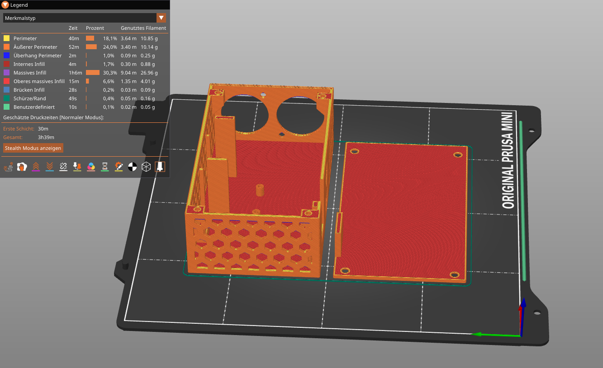

The enclosure is 3D-printable, and all print files live in `assets/case/`. If
you would rather adapt the model than slice it as-is, the current case is also
on [OnShape](https://cad.onshape.com/documents/7363818fd18bf0cbf094790e/w/52455282b39e47fbde5d0e53/e/9bec98aa83a813dc9a4d6ab2),
from where you can export it in any format you like.

> [!WARNING]
> The current design has [known issues](https://github.com/HendrikRauh/dmx-interface/issues/92).
> We are currently reworking the case on the [case branch](https://github.com/HendrikRauh/dmx-interface/tree/case).
> There we decided to use [build123d](https://build123d.readthedocs.io/en/latest/)
> to model the case. It is like [OpenSCAD](https://openscad.org/) but with some
> advantages. Feel free to [contribute](./development.md#contributing) to it!

## Print hardware

In addition to the 3D print, the case needs some parts for assembly.

| Count | Part | Location |
| ---: | --- | --- |
| 6x | M2x5 screw | Case lid, ESP32 |
| 2x | M2.5x5 screw | W5500 |
| 4x | M3 screw | XLR sockets |
| 4x | M3 nut | XLR sockets |
