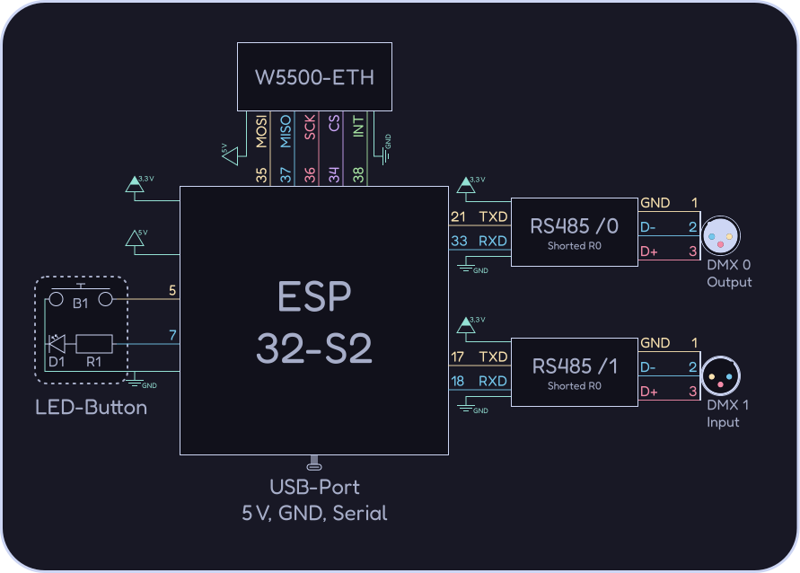
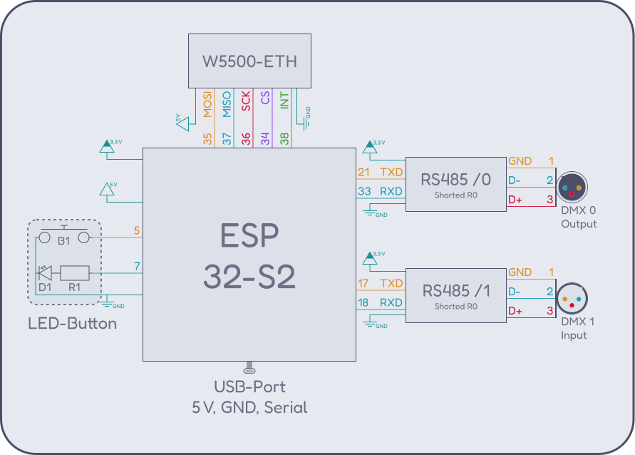

## Bill of materials

The vendor links are examples — any compatible part works. You also need wires,
soldering equipment, a 3D printer for the [case](./case.md), screws and
heat-shrink tubing.

| Count | Part |
| ---: | --- |
| 1x | [ESP32 (Lolin S2 Mini)](https://de.aliexpress.com/item/1005006985001838.html) |
| 2x | [RS-485 transceiver board](https://de.aliexpress.com/item/1005006391142478.html) |
| 1x | [W5500 Ethernet module](https://de.aliexpress.com/item/1005006127400904.html) |
| 1x | [LED-button module](https://de.aliexpress.com/item/1005003595039032.html) |
| 1x | Male XLR socket |
| 1x | Female XLR socket |

## Wiring

The circuit diagram below is the reference how we use the GPIOs. If you want to use different pins you can change the pin-definitions in `src/boards/s2_mini.rs` to match your setup.

> [!IMPORTANT]
> Enable the DMX termination resistor on the first and last device in the
> chain. On the RS-485 boards used here this means short-circuiting `R0`.

| GPIO | Usage |
| ---: | --- |
| GND | Common ground |
| 3.3 V | VIN on RS-485 boards |
| 5 V / VBUS | VIN on W5500 |
| 0 | Onboard BOOT button |
| 5 | External button |
| 7 | External status LED (via MOSFET) |
| 15 | Onboard LED |
| 16 | RS-485 DE/RE direction |
| 17 | DMX UART1 TX |
| 18 | DMX UART1 RX |
| 21 | DMX UART0 TX |
| 33 | DMX UART0 RX |
| 34 | W5500 SPI CS |
| 35 | W5500 SPI MOSI |
| 36 | W5500 SPI SCK |
| 37 | W5500 SPI MISO |

> [!TIP]
> If you want to use a [case](./case.md) you might need to install the button with the led first and then solder the wires.
